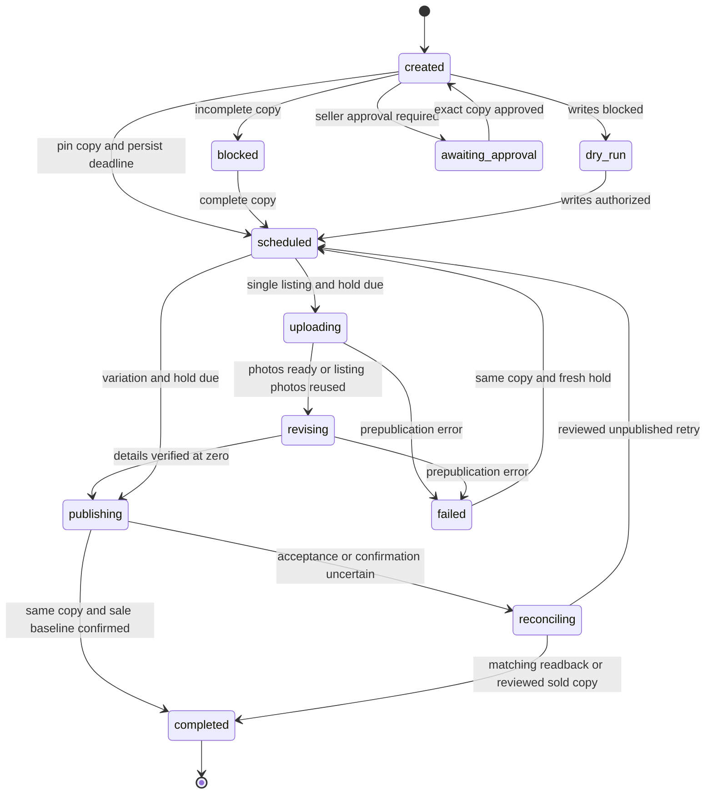

# Nextinstock state machines and recovery

The audit and hardening are integrated with the November 9, 2026 main branch. Current main uses the release-line editor, identical stock, per-copy approval and timing, and bulk price rules. Removed commerce and packaging flows are excluded from this inventory.

## Handoff protocol

Each scheduled or approved run owns its physical copy and sale baseline. Uncertain publication blocks automatic writes and queue edits. A copy that sells before readback requires review before the queue advances. Reviewed retries require a fresh zero-stock read, an unchanged sale baseline, and a new hold. Single listings and variations use the same recovery rules.

## Runtime inventory

| Workflow | States, guards, and recovery | Source |
| --- | --- | --- |
| Task monitoring | Active, scheduled, processing, awaiting approval, reconciling, dry-run, attention/error, paused. Both direct and batch checks respect pause. | [worker](../src/lib/server/restock-worker.ts) |
| Sale arming | Waiting for sale → eligible at zero. Existing stock holds for review; confirmation rearms from the verified baseline. | [sale trigger](../src/lib/server/sale-trigger.ts) |
| Physical copy queue | Queued → applying → live → archived. Failure preserves copy identity; reserved copies lock edits. Refill preserves pause. | [database](../src/lib/server/database.ts) |
| Handoff transitions | A validated graph rejects impossible transitions; unresolved runs take precedence over later sales. | [transition graph](../src/lib/server/handoff-state.ts) |
| Approval | Exact queued copy → reserved waiting run → approval recorded → scheduled. Pause blocks approval; repeated approval has no effect. | [approval API](../src/app/api/tasks/[taskId]/approve/route.ts) |
| Hold deadline | Persisted deadline → waiting → due. Per-copy timing overrides task timing. Safe retries receive a fresh hold; approved copies use a short hold. | [worker](../src/lib/server/restock-worker.ts) |
| Execution ownership | Free/expired → acquired → renewed → released. Sibling variations exclude each other at item level. | [database](../src/lib/server/database.ts) |
| Intake and request receipts | Validate target and files → normalize → commit files, copies, and receipt. Replays return the committed task; failure removes only unreferenced images. | [intake API](../src/app/api/tasks/[taskId]/copies/route.ts) |
| Bulk insertion | Validate count/prices/anchor → insert all copies with timing, approval and grade → commit one receipt. Any failure rolls back the entire batch. | [database](../src/lib/server/database.ts) |
| Combined task edits | Settings, order and prices commit together. Failure restores the previous complete task; active leases and handoffs block edits. | [task API](../src/app/api/tasks/[taskId]/route.ts) |
| eBay photo receipts | Local → uploaded with expiry → reusable while fresh. Unknown/expired receipts upload again. Identical copies reuse listing photos. | [worker](../src/lib/server/restock-worker.ts) |
| Credential persistence | Environment/local grant → configured credentials. Secret files replace atomically; required credentials participate in the live-write gate. | [configuration](../src/lib/server/config.ts) |
| OAuth consent | Challenge cookie → validated callback → grant saved → cookie cleared. Failure clears the challenge and returns a visible outcome. | [callback](../src/app/api/ebay/auth/callback/route.ts) |
| Access token cache | Missing/stale → shared refresh for one credential identity → fresh. Account switches neither join nor overwrite another identity's pending request. | [eBay client](../src/lib/server/ebay.ts) |
| Out-of-stock preference cache | Unknown/expired → known true/false or short-lived unknown; keyed by credential identity. | [eBay client](../src/lib/server/ebay.ts) |
| Seller profile cache | Missing/stale → pending per identity → cached. Late results cannot replace the current account's profile. | [profile](../src/lib/server/ebay-profile.ts) |
| Discord connection/preferences | Disconnected → endpoint verified → saved → avatar configured or warning. Replacements isolate old destinations; alert toggles persist atomically. | [integration API](../src/app/api/integrations/discord/route.ts) |
| Discord outbox | Pending → destination-specific claimed delivery → sent or retry after backoff. Expired claims recover; one failed row does not block later rows. | [Discord](../src/lib/server/discord.ts) |
| Tool navigation | Listings/activity/settings/support, new-listing builder, or selected release line. Approval links open the selected task. | [tool](../src/components/tool-prototype.tsx) |
| Listing lookup and creation | Edited → loading → validated snapshot/error → saving. Editing/unmount aborts lookup; stale targets cannot submit; repeated submissions reuse a receipt. | [builder](../src/components/tool-prototype.tsx) |
| Dashboard refresh | Complete snapshot or retained data with an error. Every HTTP response is checked; superseded requests abort; pending local mutations survive polling. | [tool](../src/components/tool-prototype.tsx) |
| Task mutations | Independent per-task pending counts and serial operations. Optimistic order/prices cannot race server requests; failure restores or refreshes the saved state. | [tool](../src/components/tool-prototype.tsx) |
| Release-line selection/drag | Copy/stack/link/add selection; drag preview → valid drop → persisted order. Selection follows stack membership and queue removal; locked handoffs disable edits. | [release line](../src/components/release-line.tsx) |
| Copy drafts | Untouched → dirty → saving → confirmed/error. Server refreshes preserve unsaved price, reference and note drafts; failed saves retain recoverable state. | [release line](../src/components/release-line.tsx) |
| Variation display preferences | Default/saved subset, search, show-all and selected target. Empty subsets round-trip; unavailable browser storage preserves the local view. | [variation picker](../src/components/tool-prototype.tsx) |
| Toast lifetime | Hidden → message → timeout; replacement/unmount cancels the previous timer. | [tool](../src/components/tool-prototype.tsx) |
| Avatar fallback | URL → rendered image or initials. URL/account changes retry; configured credentials are distinguished from verified identity. | [tool](../src/components/tool-prototype.tsx) |
| Photo previews | Files → object URLs → preview → revoked on replacement/unmount. Distinct-copy saving retains its draft after an error. | [release line](../src/components/release-line.tsx) |
| Favicon cycle | Four colors with hidden-tab and reduced-motion suspension; listeners/timers clean up on unmount. | [favicon](../src/components/favicon-cycle.tsx) |
| Continuous worker | Start → tick → interruptible sleep → tick → stopping. Heartbeat distinguishes running/stale/stopped; one-shot checks preserve watcher health. | [worker process](../scripts/restock-worker.ts) |
| Local supervisor | Start children → running → child exit/error or signal → stop both. A watchdog terminates children that fail to exit. | [supervisor](../scripts/start-local.mjs) |
| SQLite startup | Open → serialized schema transaction → cached connection. Failure rolls back and closes so a repaired database can retry. | [database](../src/lib/server/database.ts) |

## Supporting flows and derived gates

| Flow | Behavior | Source |
| --- | --- | --- |
| Listing eligibility | Listing shape, stock, status, preference and variation identity produce support reasons and blockers. | [worker](../src/lib/server/restock-worker.ts) |
| Live-write permission | Mode, persistent storage, application credentials, local grant and scopes select authorized/blocked. | [configuration](../src/lib/server/config.ts) |
| Hosted/local access | Hosted builds block local-tool routes; Discord mutations additionally require a local same-origin JSON request. | [proxy](../src/proxy.ts) |
| Marketing release line | Local illustration state for selection, timing, grading, drag order and preview pause. Does not mutate seller inventory. | [hero](../src/components/hero-release-line.tsx) |
| Video showcase | Selection, visibility, playback and progress; stale playback failures and preference listeners clean up. | [showcase](../src/components/repeat-stock-showcase.tsx) |
| Marketing recording | Scripted fixture state is separate from the operational worker. | [recorder](../scripts/record-marketing-demo.mjs) |
| Local setup | Creates a missing environment file, preserves an existing file, and reports legacy local data. | [setup](../scripts/setup-local.mjs) |
| Copy command feedback | Clipboard pending → success/error → feedback reset, with native text selection fallback. | [copy command](../src/components/copy-command.tsx) |

## Verification

`npm run check`, `npm test` (54 passing), and `npm run build` pass against the integrated tree. Regression coverage includes single/variation publication recovery, sale-before-confirmation, reviewed recovery, approval across pause/resume, pinned-copy locks, per-copy timing, identical stock, atomic batches and combined edits, concurrent intake replay, image cleanup, account changes during pending requests, OAuth cookies, concurrent migration, outbox claims, and worker shutdown.

Browser checks use the production build with intercepted fixture APIs. Live eBay and Discord mutations are separate verification steps; no provider writes are performed by these checks. A Git push is distinct from verification of a deployed site or a running seller worker.
